# Piano paso a paso

Dibujos de los acordes de **Moonlight** y **Neela**, en el orden en que aparecen en cada vídeo, incluidas las repeticiones.

[Ir a Moonlight](#moonlight) · [Ir a Neela](#neela) · [Guía para principiantes](acordes_piano.md)

Pulsa las **teclas verdes con un punto** de cada dibujo. Empieza despacio: puedes tocarlas una a una y después juntas. Cada paso representa un tramo con el mismo acorde; no indica cuántas veces pulsarlo ni reproduce el ritmo o la melodía completos.

Los tiempos se cuentan desde el inicio del vídeo. Sigue los pasos de arriba abajo y cambia de dibujo al llegar al tiempo indicado. La transcripción es aproximada; «Revisar» señala los tramos menos fiables. Las posiciones de los dibujos son propuestas para practicar.

## Moonlight

[Abrir vídeo: Moonlight.mp4](Moonlight.mp4)

**00:00.0 → 00:04.0 · Pausa / audio débil:** no hay un acorde identificado en este tramo.

### Paso 1 · 00:04.0 → 00:09.0

**Do sostenido menor (C#m)** · Do♯ – Mi – La♭

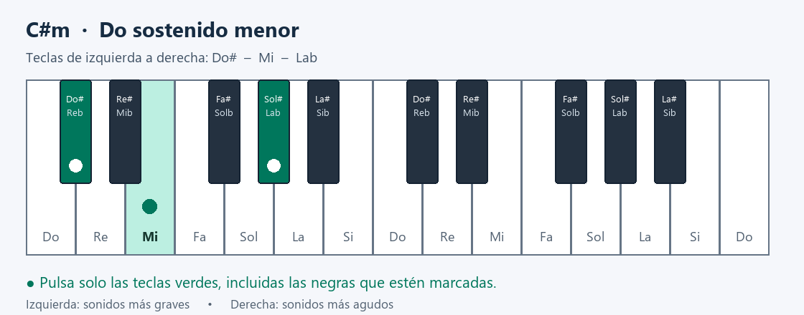

### Paso 2 · 00:09.0 → 00:11.0

**Do sostenido menor con séptima (C#m7)** · Do♯ – Mi – La♭ – Si

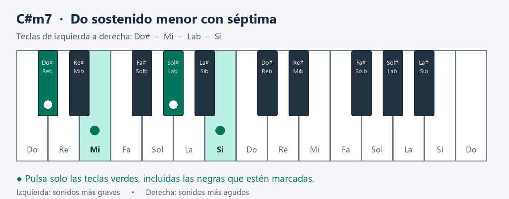

### Paso 3 · 00:11.0 → 00:13.5

**Do sostenido menor (C#m)** · Do♯ – Mi – La♭

### Paso 4 · 00:13.5 → 00:16.5

**La mayor (A)** · La – Do♯ – Mi

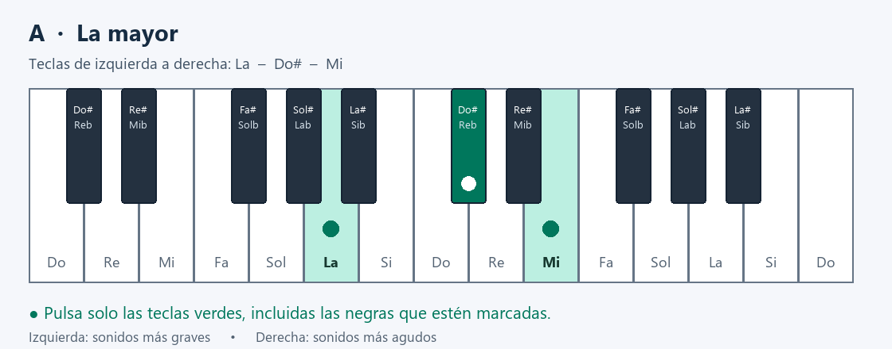

### Paso 5 · 00:16.5 → 00:19.0

**Re mayor (D)** · Re – Fa♯ – La

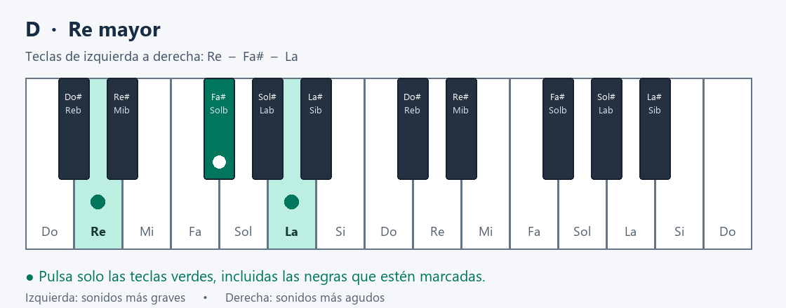

### Paso 6 · 00:19.0 → 00:20.5

**La bemol mayor (Ab)** · La♭ – Do – Mi♭

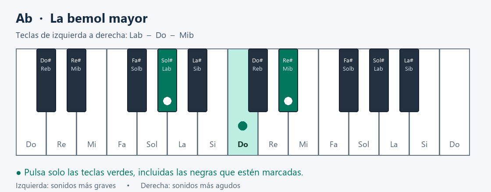

### Paso 7 · 00:20.5 → 00:22.0

**Do sostenido menor (C#m)** · Do♯ – Mi – La♭

### Paso 8 · 00:22.0 → 00:23.0

**La bemol con cuarta suspendida (Absus4)** · La♭ – Do♯ – Mi♭

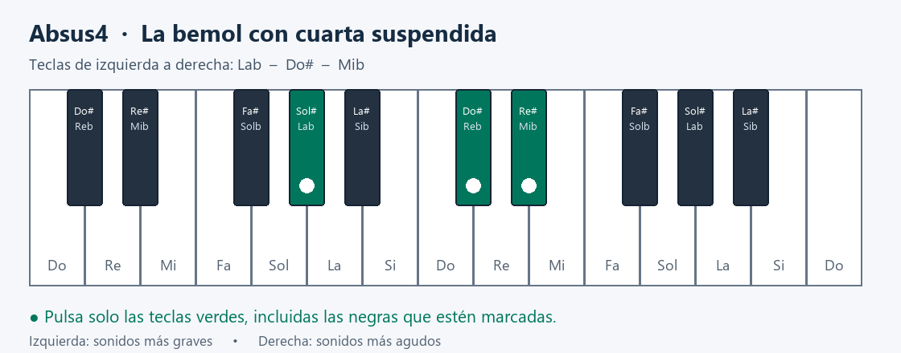

### Paso 9 · 00:23.0 → 00:24.0

**Do disminuido (Cdim)** · Do – Mi♭ – Fa♯

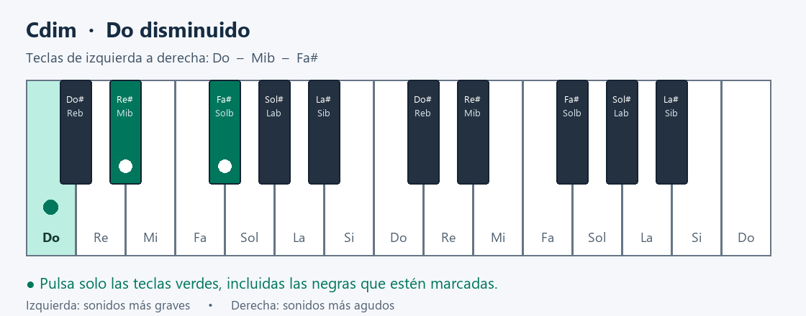

### Paso 10 · 00:24.0 → 00:29.5

**Do sostenido menor (C#m)** · Do♯ – Mi – La♭

### Paso 11 · 00:29.5 → 00:34.0

**La bemol mayor (Ab)** · La♭ – Do – Mi♭

### Paso 12 · 00:34.0 → 00:36.5

**Do sostenido menor (C#m)** · Do♯ – Mi – La♭

### Paso 13 · 00:36.5 → 00:39.0

**La mayor (A)** · La – Do♯ – Mi

### Paso 14 · 00:39.0 → 00:41.5

**Mi mayor (E)** · Mi – La♭ – Si

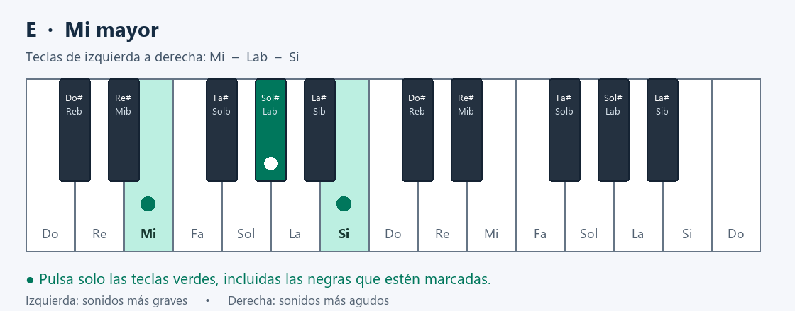

### Paso 15 · 00:41.5 → 00:42.0

**Mi con cuarta suspendida (Esus4)** · Mi – La – Si

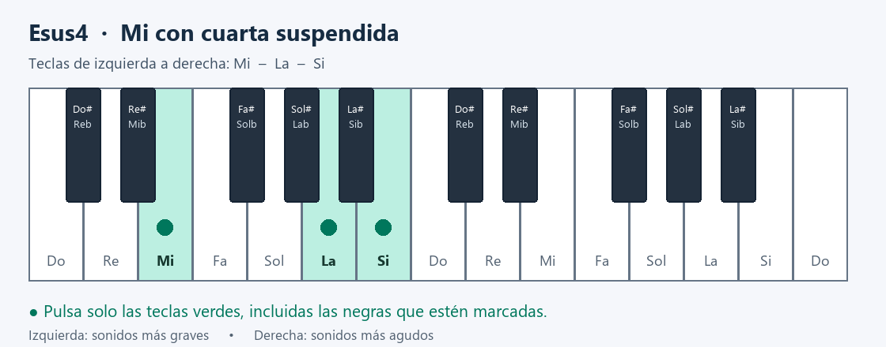

### Paso 16 · 00:42.0 → 00:44.0

**Si con séptima (B7)** · Si – Mi♭ – Fa♯ – La

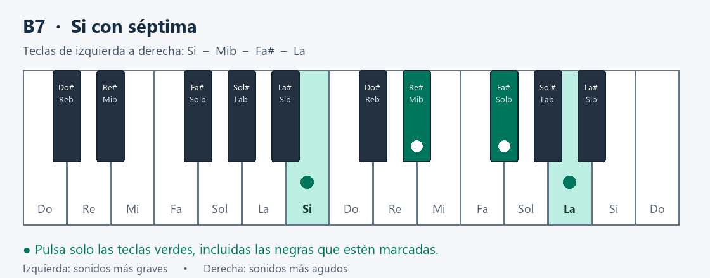

### Paso 17 · 00:44.0 → 00:49.0

**Mi mayor (E)** · Mi – La♭ – Si

### Paso 18 · 00:49.0 → 00:54.5

**Mi menor (Em)** · Mi – Sol – Si

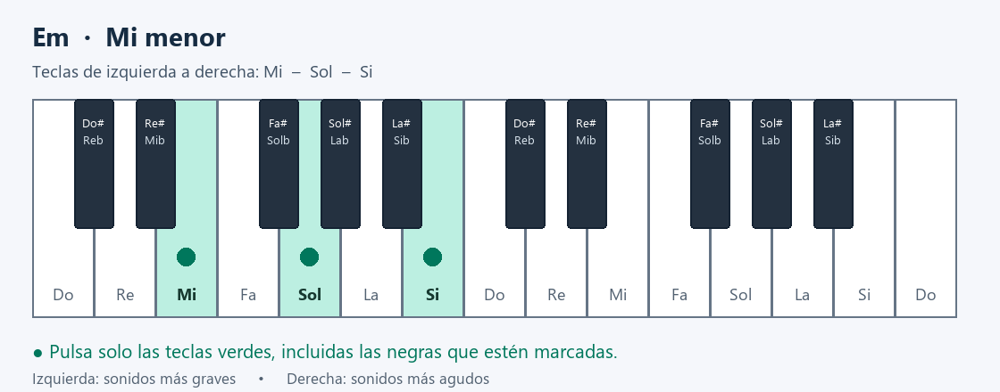

### Paso 19 · 00:54.5 → 00:59.5

**Sol con séptima (G7)** · Sol – Si – Re – Fa

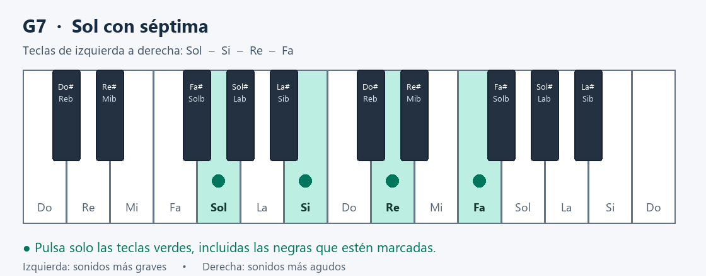

### Paso 20 · 00:59.5 → 01:00.5

**Do mayor (C)** · Do – Mi – Sol

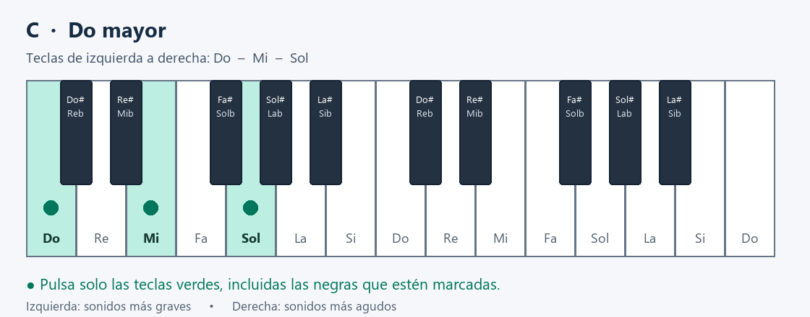

### Paso 21 · 01:00.5 → 01:02.0

**Mi menor (Em)** · Mi – Sol – Si

### Paso 22 · 01:02.0 → 01:03.0

**Do sostenido disminuido (C#dim)** · Do♯ – Mi – Sol

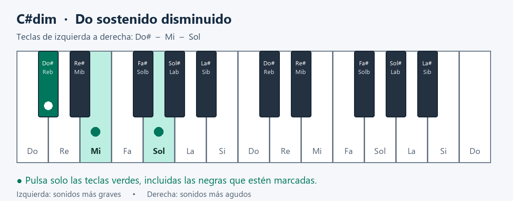

### Paso 23 · 01:03.0 → 01:04.5

**Fa sostenido con séptima (F#7)** · Fa♯ – Si♭ – Do♯ – Mi

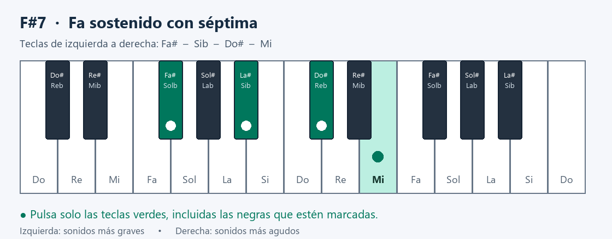

### Paso 24 · 01:04.5 → 01:06.5

**Si menor (Bm)** · Si – Re – Fa♯

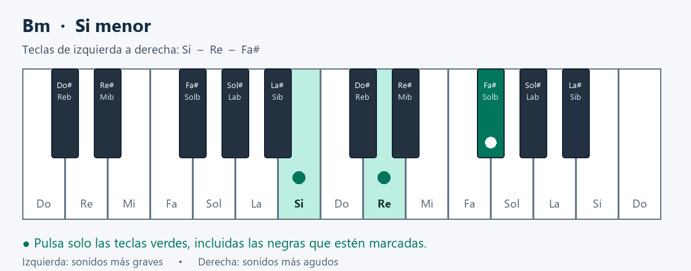

### Paso 25 · 01:06.5 → 01:07.5

**Sol mayor (G)** · Sol – Si – Re

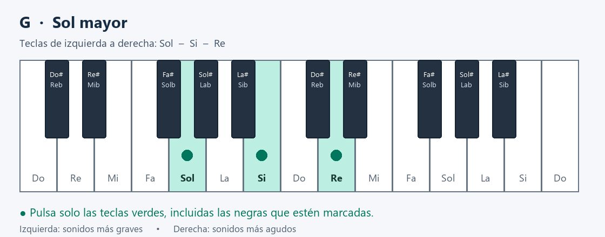

### Paso 26 · 01:07.5 → 01:09.0

**Mi menor (Em)** · Mi – Sol – Si

### Paso 27 · 01:09.0 → 01:09.5

**Fa sostenido con cuarta suspendida (F#sus4)** · Fa♯ – Si – Do♯

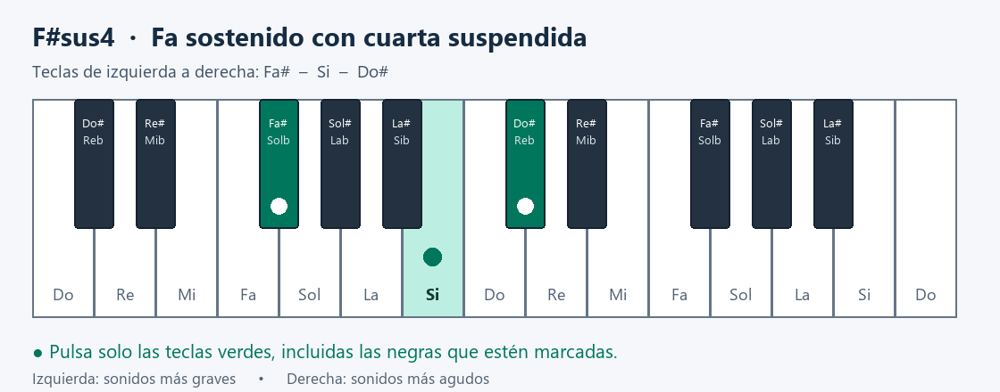

### Paso 28 · 01:09.5 → 01:11.5

**Si menor (Bm)** · Si – Re – Fa♯

### Paso 29 · 01:11.5 → 01:14.0

**Fa sostenido mayor (F#)** · Fa♯ – Si♭ – Do♯

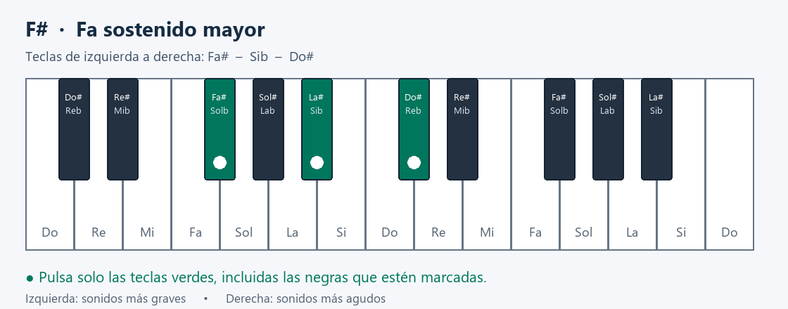

### Paso 30 · 01:14.0 → 01:16.5

**Si menor (Bm)** · Si – Re – Fa♯

### Paso 31 · 01:16.5 → 01:19.0

**Si mayor (B)** · Si – Mi♭ – Fa♯

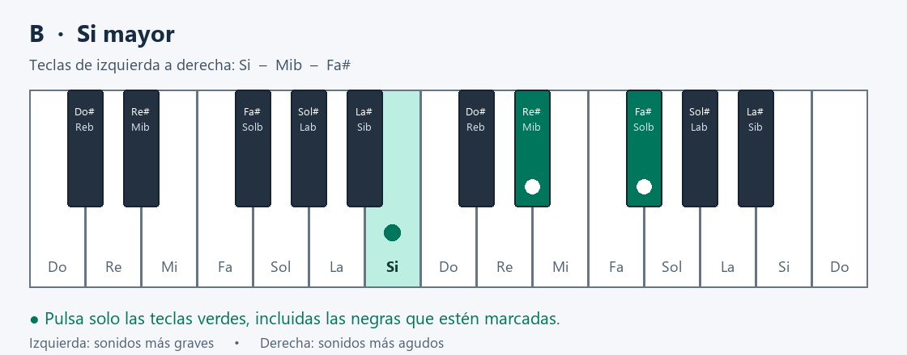

### Paso 32 · 01:19.0 → 01:20.0

**Do con séptima mayor (Cmaj7)** · Do – Mi – Sol – Si

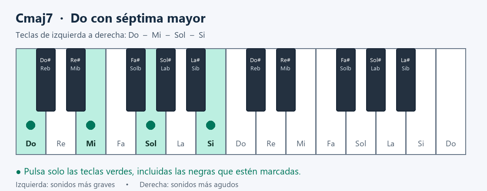

### Paso 33 · 01:20.0 → 01:24.0

**Mi menor (Em)** · Mi – Sol – Si

### Paso 34 · 01:24.0 → 01:29.0

**Si mayor (B)** · Si – Mi♭ – Fa♯

### Paso 35 · 01:29.0 → 01:30.0

**Do con séptima mayor (Cmaj7)** · Do – Mi – Sol – Si

### Paso 36 · 01:30.0 → 01:34.0

**Mi menor (Em)** · Mi – Sol – Si

### Paso 37 · 01:34.0 → 01:37.0

**Si mayor (B)** · Si – Mi♭ – Fa♯

### Paso 38 · 01:37.0 → 01:39.5

**Si disminuido (Bdim)** · Si – Re – Fa

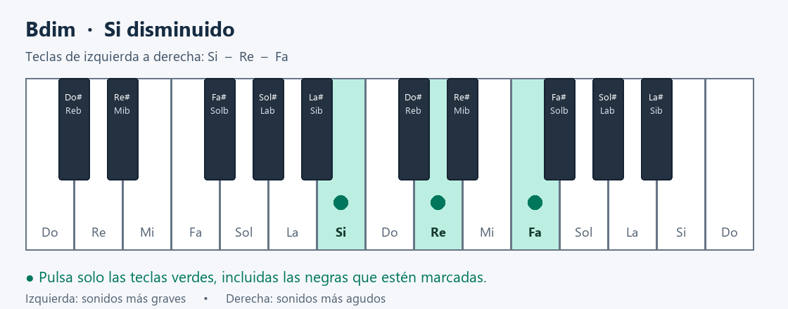

### Paso 39 · 01:39.5 → 01:41.5

**Do sostenido con séptima (C#7)** · Do♯ – Fa – La♭ – Si

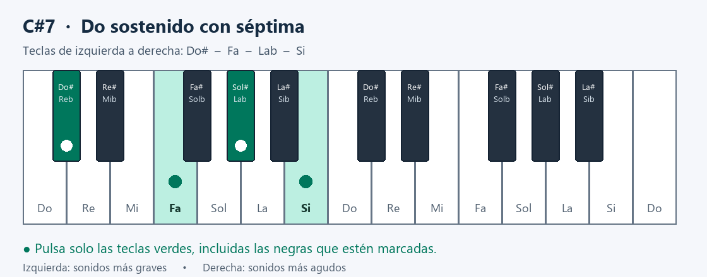

### Paso 40 · 01:41.5 → 01:44.0

**Fa sostenido menor (F#m)** · Fa♯ – La – Do♯

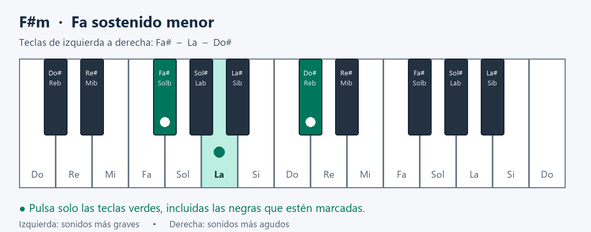

### Paso 41 · 01:44.0 → 01:47.0

**Sol mayor (G)** · Sol – Si – Re

### Paso 42 · 01:47.0 → 01:49.0

**Mi bemol disminuido (Ebdim)** · Mi♭ – Fa♯ – La

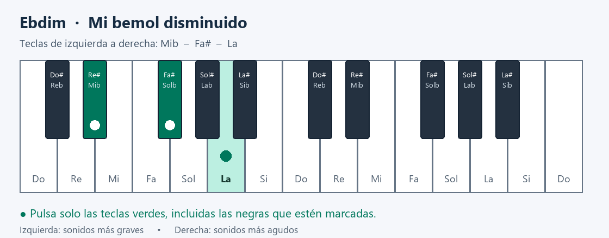

### Paso 43 · 01:49.0 → 01:52.5

**Fa sostenido menor (F#m)** · Fa♯ – La – Do♯

### Paso 44 · 01:52.5 → 01:54.5

**Do sostenido mayor (C#)** · Do♯ – Fa – La♭

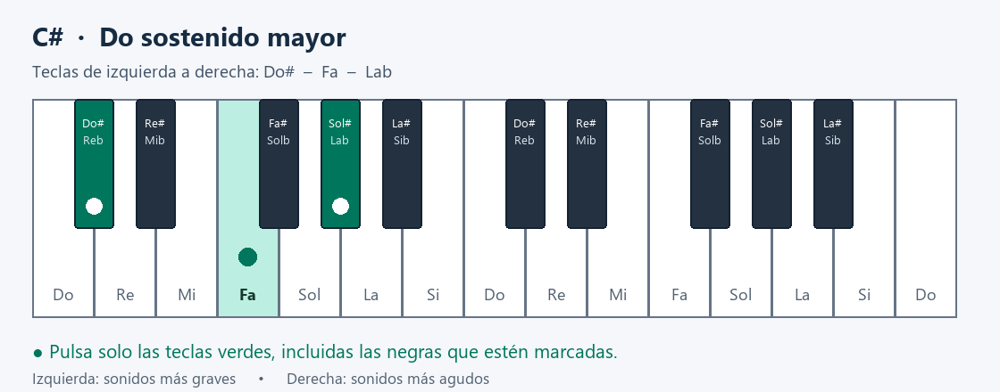

### Paso 45 · 01:54.5 → 01:59.5

**Fa sostenido menor (F#m)** · Fa♯ – La – Do♯

### Paso 46 · 01:59.5 → 02:04.0

**Do sostenido mayor (C#)** · Do♯ – Fa – La♭

### Paso 47 · 02:04.0 → 02:06.0

**Fa sostenido menor (F#m)** · Fa♯ – La – Do♯

### Paso 48 · 02:06.0 → 02:07.5

**Fa sostenido disminuido (F#dim)** · Fa♯ – La – Do

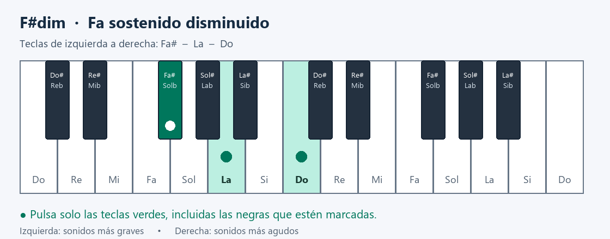

### Paso 49 · 02:07.5 → 02:09.0

**Fa sostenido menor (F#m)** · Fa♯ – La – Do♯

### Paso 50 · 02:09.0 → 02:14.0

**La bemol mayor (Ab)** · La♭ – Do – Mi♭

### Paso 51 · 02:14.0 → 02:16.5

**Do sostenido menor (C#m)** · Do♯ – Mi – La♭

### Paso 52 · 02:16.5 → 02:17.5

**Mi bemol disminuido (Ebdim)** · Mi♭ – Fa♯ – La

*Revisar: este tramo tiene una detección menos fiable.*

### Paso 53 · 02:17.5 → 02:19.0

**La mayor (A)** · La – Do♯ – Mi

### Paso 54 · 02:19.0 → 02:21.5

**La bemol mayor (Ab)** · La♭ – Do – Mi♭

### Paso 55 · 02:21.5 → 02:23.0

**La disminuido (Adim)** · La – Do – Mi♭

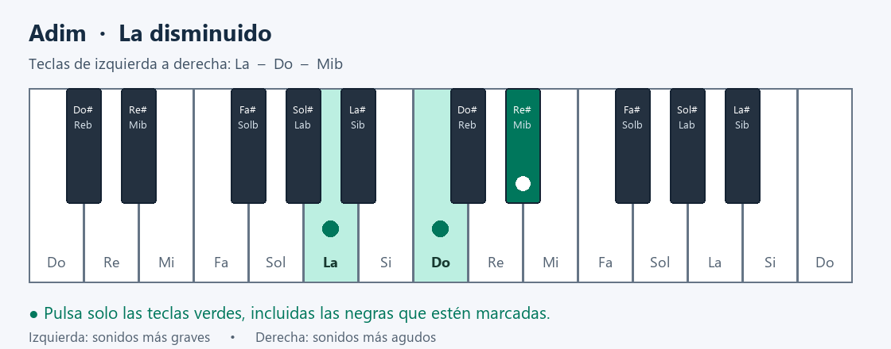

### Paso 56 · 02:23.0 → 02:26.5

**La bemol mayor (Ab)** · La♭ – Do – Mi♭

### Paso 57 · 02:26.5 → 02:28.0

**La disminuido (Adim)** · La – Do – Mi♭

### Paso 58 · 02:28.0 → 02:29.0

**Do disminuido (Cdim)** · Do – Mi♭ – Fa♯

### Paso 59 · 02:29.0 → 02:39.0

**Do sostenido menor (C#m)** · Do♯ – Mi – La♭

### Paso 60 · 02:39.0 → 02:40.0

**La bemol mayor (Ab)** · La♭ – Do – Mi♭

### Paso 61 · 02:40.0 → 02:44.0

**La disminuido (Adim)** · La – Do – Mi♭

### Paso 62 · 02:44.0 → 02:50.5

**Do sostenido menor (C#m)** · Do♯ – Mi – La♭

### Paso 63 · 02:50.5 → 02:53.5

**Si bemol disminuido (Bbdim)** · Si♭ – Do♯ – Mi

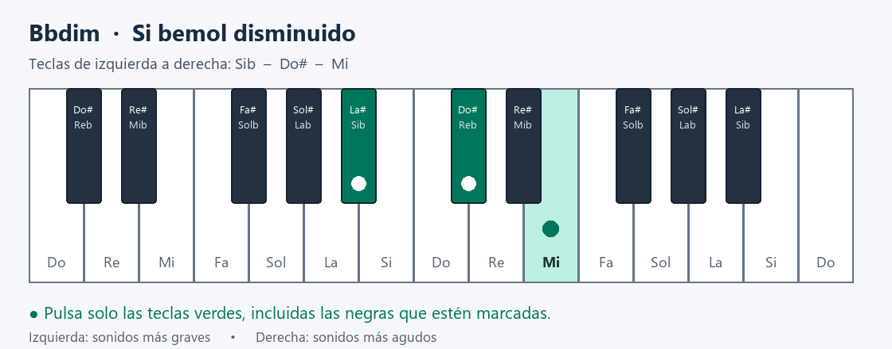

### Paso 64 · 02:53.5 → 02:54.0

**Do sostenido menor (C#m)** · Do♯ – Mi – La♭

### Paso 65 · 02:54.0 → 02:56.5

**La bemol mayor (Ab)** · La♭ – Do – Mi♭

### Paso 66 · 02:56.5 → 03:01.0

**Do con séptima disminuida (Cdim7)** · Do – Mi♭ – Fa♯ – La

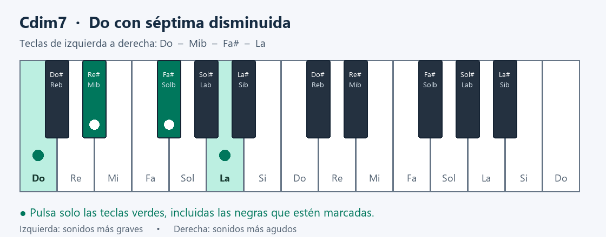

### Paso 67 · 03:01.0 → 03:06.5

**La disminuido (Adim)** · La – Do – Mi♭

### Paso 68 · 03:06.5 → 03:07.5

**Mi bemol disminuido (Ebdim)** · Mi♭ – Fa♯ – La

### Paso 69 · 03:07.5 → 03:09.0

**Fa sostenido menor (F#m)** · Fa♯ – La – Do♯

### Paso 70 · 03:09.0 → 03:10.0

**La bemol mayor (Ab)** · La♭ – Do – Mi♭

### Paso 71 · 03:10.0 → 03:11.5

**Fa sostenido disminuido (F#dim)** · Fa♯ – La – Do

### Paso 72 · 03:11.5 → 03:12.5

**Mi bemol disminuido (Ebdim)** · Mi♭ – Fa♯ – La

### Paso 73 · 03:12.5 → 03:14.0

**Fa sostenido menor (F#m)** · Fa♯ – La – Do♯

### Paso 74 · 03:14.0 → 03:15.5

**La bemol mayor (Ab)** · La♭ – Do – Mi♭

### Paso 75 · 03:15.5 → 03:16.5

**Fa sostenido disminuido (F#dim)** · Fa♯ – La – Do

### Paso 76 · 03:16.5 → 03:17.5

**Re mayor (D)** · Re – Fa♯ – La

### Paso 77 · 03:17.5 → 03:19.0

**Fa sostenido menor (F#m)** · Fa♯ – La – Do♯

### Paso 78 · 03:19.0 → 03:20.0

**Fa menor (Fm)** · Fa – La♭ – Do

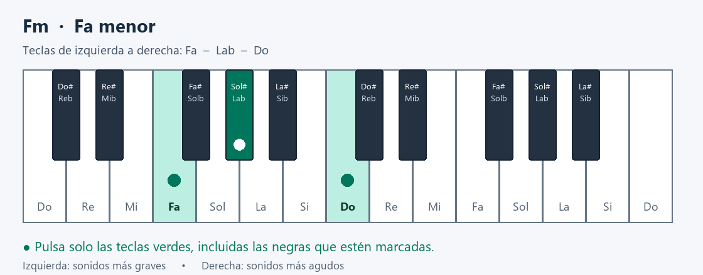

### Paso 79 · 03:20.0 → 03:21.5

**Fa sostenido disminuido (F#dim)** · Fa♯ – La – Do

### Paso 80 · 03:21.5 → 03:24.0

**La mayor (A)** · La – Do♯ – Mi

### Paso 81 · 03:24.0 → 03:26.5

**Mi bemol disminuido (Ebdim)** · Mi♭ – Fa♯ – La

### Paso 82 · 03:26.5 → 03:28.0

**La bemol mayor (Ab)** · La♭ – Do – Mi♭

### Paso 83 · 03:28.0 → 03:29.0

**Do disminuido (Cdim)** · Do – Mi♭ – Fa♯

### Paso 84 · 03:29.0 → 03:34.5

**Do sostenido menor (C#m)** · Do♯ – Mi – La♭

### Paso 85 · 03:34.5 → 03:39.0

**La bemol mayor (Ab)** · La♭ – Do – Mi♭

### Paso 86 · 03:39.0 → 03:41.0

**Do sostenido menor (C#m)** · Do♯ – Mi – La♭

### Paso 87 · 03:41.0 → 03:44.0

**La mayor (A)** · La – Do♯ – Mi

### Paso 88 · 03:44.0 → 03:47.0

**Mi mayor (E)** · Mi – La♭ – Si

### Paso 89 · 03:47.0 → 03:49.0

**Si con séptima (B7)** · Si – Mi♭ – Fa♯ – La

### Paso 90 · 03:49.0 → 03:54.5

**Mi mayor (E)** · Mi – La♭ – Si

### Paso 91 · 03:54.5 → 03:59.5

**Mi con cuarta suspendida (Esus4)** · Mi – La – Si

### Paso 92 · 03:59.5 → 04:01.5

**Mi mayor (E)** · Mi – La♭ – Si

### Paso 93 · 04:01.5 → 04:02.5

**Fa menor (Fm)** · Fa – La♭ – Do

### Paso 94 · 04:02.5 → 04:04.0

**Do sostenido menor (C#m)** · Do♯ – Mi – La♭

### Paso 95 · 04:04.0 → 04:06.5

**La bemol mayor (Ab)** · La♭ – Do – Mi♭

### Paso 96 · 04:06.5 → 04:09.0

**Do sostenido menor (C#m)** · Do♯ – Mi – La♭

### Paso 97 · 04:09.0 → 04:11.0

**Re mayor (D)** · Re – Fa♯ – La

### Paso 98 · 04:11.0 → 04:12.0

**Fa sostenido disminuido (F#dim)** · Fa♯ – La – Do

### Paso 99 · 04:12.0 → 04:13.5

**Fa menor (Fm)** · Fa – La♭ – Do

### Paso 100 · 04:13.5 → 04:16.5

**Do sostenido menor (C#m)** · Do♯ – Mi – La♭

### Paso 101 · 04:16.5 → 04:19.5

**Do sostenido mayor (C#)** · Do♯ – Fa – La♭

### Paso 102 · 04:19.5 → 04:22.5

**Fa sostenido menor (F#m)** · Fa♯ – La – Do♯

### Paso 103 · 04:22.5 → 04:23.5

**Fa sostenido disminuido (F#dim)** · Fa♯ – La – Do

*Revisar: este tramo tiene una detección menos fiable.*

### Paso 104 · 04:23.5 → 04:24.0

**Fa sostenido menor (F#m)** · Fa♯ – La – Do♯

### Paso 105 · 04:24.0 → 04:29.5

**Do sostenido mayor (C#)** · Do♯ – Fa – La♭

### Paso 106 · 04:29.5 → 04:32.5

**Fa sostenido menor (F#m)** · Fa♯ – La – Do♯

### Paso 107 · 04:32.5 → 04:33.5

**Fa sostenido disminuido (F#dim)** · Fa♯ – La – Do

### Paso 108 · 04:33.5 → 04:34.0

**Fa sostenido menor (F#m)** · Fa♯ – La – Do♯

### Paso 109 · 04:34.0 → 04:37.0

**Do sostenido mayor (C#)** · Do♯ – Fa – La♭

### Paso 110 · 04:37.0 → 04:39.0

**Fa sostenido menor (F#m)** · Fa♯ – La – Do♯

### Paso 111 · 04:39.0 → 04:45.5

**Mi con cuarta suspendida (Esus4)** · Mi – La – Si

### Paso 112 · 04:45.5 → 04:46.5

**Mi bemol disminuido (Ebdim)** · Mi♭ – Fa♯ – La

### Paso 113 · 04:46.5 → 04:48.0

**La bemol mayor (Ab)** · La♭ – Do – Mi♭

### Paso 114 · 04:48.0 → 04:49.5

**Do sostenido menor (C#m)** · Do♯ – Mi – La♭

### Paso 115 · 04:49.5 → 04:51.0

**Mi bemol menor con séptima (Ebm7)** · Mi♭ – Fa♯ – Si♭ – Do♯

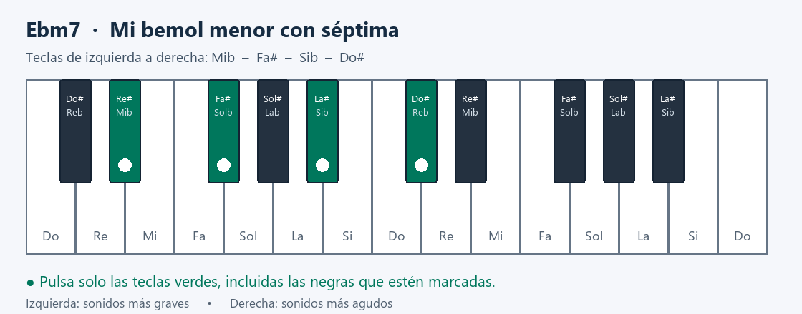

### Paso 116 · 04:51.0 → 04:52.5

**La bemol con cuarta suspendida (Absus4)** · La♭ – Do♯ – Mi♭

### Paso 117 · 04:52.5 → 04:54.0

**La disminuido (Adim)** · La – Do – Mi♭

### Paso 118 · 04:54.0 → 04:54.5

**La bemol con cuarta suspendida (Absus4)** · La♭ – Do♯ – Mi♭

### Paso 119 · 04:54.5 → 04:57.0

**Do sostenido menor (C#m)** · Do♯ – Mi – La♭

### Paso 120 · 04:57.0 → 04:59.0

**Do disminuido (Cdim)** · Do – Mi♭ – Fa♯

### Paso 121 · 04:59.0 → 05:04.5

**Do sostenido menor (C#m)** · Do♯ – Mi – La♭

### Paso 122 · 05:04.5 → 05:09.0

**La bemol mayor (Ab)** · La♭ – Do – Mi♭

### Paso 123 · 05:09.0 → 05:14.0

**Do sostenido menor (C#m)** · Do♯ – Mi – La♭

### Paso 124 · 05:14.0 → 05:15.5

**La bemol mayor (Ab)** · La♭ – Do – Mi♭

### Paso 125 · 05:15.5 → 05:17.5

**La disminuido (Adim)** · La – Do – Mi♭

### Paso 126 · 05:17.5 → 05:18.5

**La bemol mayor (Ab)** · La♭ – Do – Mi♭

### Paso 127 · 05:18.5 → 05:24.0

**Do sostenido menor (C#m)** · Do♯ – Mi – La♭

### Paso 128 · 05:24.0 → 05:25.5

**La bemol mayor (Ab)** · La♭ – Do – Mi♭

### Paso 129 · 05:25.5 → 05:27.5

**La disminuido (Adim)** · La – Do – Mi♭

### Paso 130 · 05:27.5 → 05:28.5

**La bemol mayor (Ab)** · La♭ – Do – Mi♭

### Paso 131 · 05:28.5 → 05:53.5

**Do sostenido menor (C#m)** · Do♯ – Mi – La♭

### Paso 132 · 05:53.5 → 05:54.0

**Do sostenido con séptima mayor (C#maj7)** · Do♯ – Fa – La♭ – Do

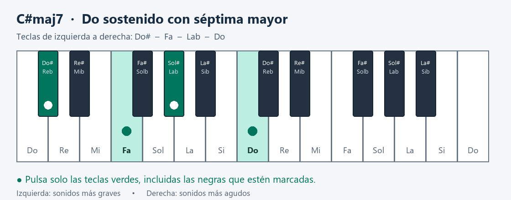

**05:54.0 → 05:56.0 · Pausa / audio débil:** no hay un acorde identificado en este tramo.

### Paso 133 · 05:56.0 → 05:59.0

**Re menor (Dm)** · Re – Fa – La

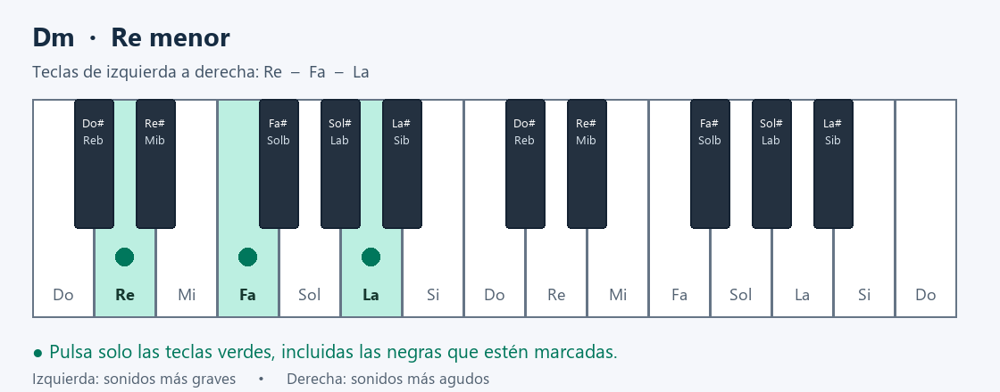

### Paso 134 · 05:59.0 → 06:02.0

**Fa mayor (F)** · Fa – La – Do

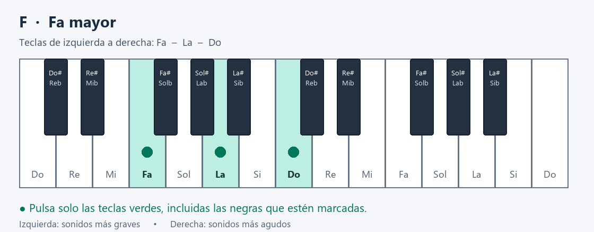

### Paso 135 · 06:02.0 → 06:04.0

**Do mayor (C)** · Do – Mi – Sol

### Paso 136 · 06:04.0 → 06:07.0

**La mayor (A)** · La – Do♯ – Mi

### Paso 137 · 06:07.0 → 06:08.0

**Re mayor (D)** · Re – Fa♯ – La

**06:08.0 → 06:12.5 · Pausa / audio débil:** no hay un acorde identificado en este tramo.

[Volver al inicio](#piano-paso-a-paso)

## Neela

[Abrir vídeo: Neela.mp4](Neela.mp4)

**00:00.0 → 00:03.5 · Pausa / audio débil:** no hay un acorde identificado en este tramo.

### Paso 1 · 00:03.5 → 00:12.0

**Mi menor (Em)** · Mi – Sol – Si

### Paso 2 · 00:12.0 → 00:15.0

**Sol mayor (G)** · Sol – Si – Re

### Paso 3 · 00:15.0 → 00:19.5

**Sol con cuarta suspendida (Gsus4)** · Sol – Do – Re

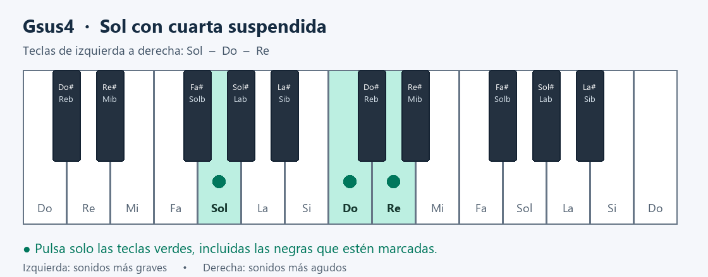

### Paso 4 · 00:19.5 → 00:22.5

**Mi menor (Em)** · Mi – Sol – Si

### Paso 5 · 00:22.5 → 00:29.5

**Sol con cuarta suspendida (Gsus4)** · Sol – Do – Re

### Paso 6 · 00:29.5 → 00:32.0

**Mi menor (Em)** · Mi – Sol – Si

### Paso 7 · 00:32.0 → 00:33.5

**Sol mayor (G)** · Sol – Si – Re

### Paso 8 · 00:33.5 → 00:36.0

**Re con cuarta suspendida (Dsus4)** · Re – Sol – La

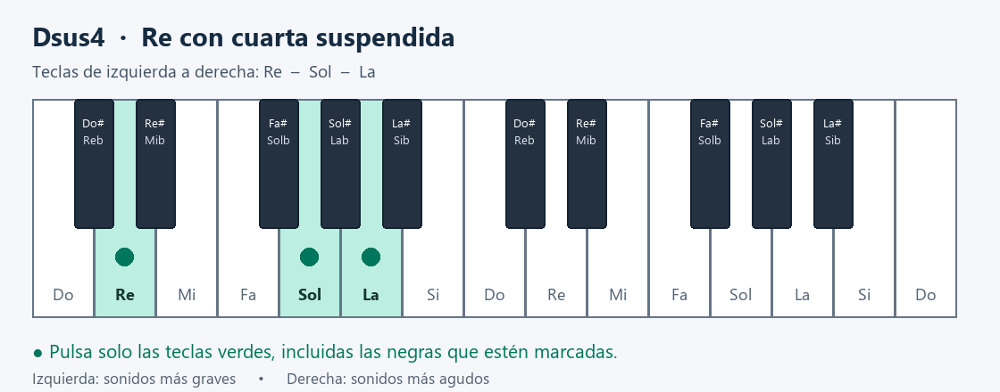

### Paso 9 · 00:36.0 → 00:39.0

**Sol con cuarta suspendida (Gsus4)** · Sol – Do – Re

### Paso 10 · 00:39.0 → 00:42.0

**Mi menor (Em)** · Mi – Sol – Si

### Paso 11 · 00:42.0 → 00:43.5

**Sol mayor (G)** · Sol – Si – Re

### Paso 12 · 00:43.5 → 00:46.0

**Re con cuarta suspendida (Dsus4)** · Re – Sol – La

### Paso 13 · 00:46.0 → 00:49.5

**Sol con cuarta suspendida (Gsus4)** · Sol – Do – Re

### Paso 14 · 00:49.5 → 00:52.0

**Mi menor (Em)** · Mi – Sol – Si

### Paso 15 · 00:52.0 → 00:53.5

**Sol con séptima mayor (Gmaj7)** · Sol – Si – Re – Fa♯

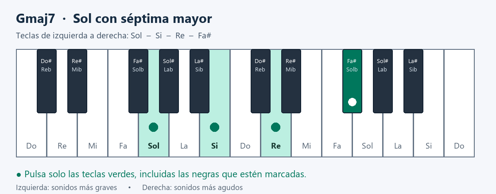

### Paso 16 · 00:53.5 → 00:59.0

**Sol con cuarta suspendida (Gsus4)** · Sol – Do – Re

### Paso 17 · 00:59.0 → 01:02.0

**Mi menor (Em)** · Mi – Sol – Si

### Paso 18 · 01:02.0 → 01:03.5

**Sol con séptima mayor (Gmaj7)** · Sol – Si – Re – Fa♯

### Paso 19 · 01:03.5 → 01:09.0

**Sol con cuarta suspendida (Gsus4)** · Sol – Do – Re

### Paso 20 · 01:09.0 → 01:11.5

**Mi menor (Em)** · Mi – Sol – Si

### Paso 21 · 01:11.5 → 01:14.0

**Sol mayor (G)** · Sol – Si – Re

### Paso 22 · 01:14.0 → 01:18.5

**Sol con cuarta suspendida (Gsus4)** · Sol – Do – Re

### Paso 23 · 01:18.5 → 01:21.0

**Mi menor (Em)** · Mi – Sol – Si

### Paso 24 · 01:21.0 → 01:23.5

**Sol mayor (G)** · Sol – Si – Re

### Paso 25 · 01:23.5 → 01:28.5

**Sol con cuarta suspendida (Gsus4)** · Sol – Do – Re

### Paso 26 · 01:28.5 → 01:31.0

**Mi menor (Em)** · Mi – Sol – Si

### Paso 27 · 01:31.0 → 01:33.0

**Sol mayor (G)** · Sol – Si – Re

### Paso 28 · 01:33.0 → 01:38.5

**Sol con cuarta suspendida (Gsus4)** · Sol – Do – Re

### Paso 29 · 01:38.5 → 01:46.0

**Mi menor (Em)** · Mi – Sol – Si

### Paso 30 · 01:46.0 → 01:49.0

**Sol mayor (G)** · Sol – Si – Re

### Paso 31 · 01:49.0 → 01:53.0

**Sol con cuarta suspendida (Gsus4)** · Sol – Do – Re

### Paso 32 · 01:53.0 → 01:56.5

**Mi menor (Em)** · Mi – Sol – Si

### Paso 33 · 01:56.5 → 02:03.5

**Sol con cuarta suspendida (Gsus4)** · Sol – Do – Re

### Paso 34 · 02:03.5 → 02:06.5

**Mi menor (Em)** · Mi – Sol – Si

### Paso 35 · 02:06.5 → 02:10.5

**Re con cuarta suspendida (Dsus4)** · Re – Sol – La

### Paso 36 · 02:10.5 → 02:13.0

**Sol con cuarta suspendida (Gsus4)** · Sol – Do – Re

### Paso 37 · 02:13.0 → 02:16.0

**Mi menor (Em)** · Mi – Sol – Si

### Paso 38 · 02:16.0 → 02:17.5

**Sol mayor (G)** · Sol – Si – Re

### Paso 39 · 02:17.5 → 02:20.0

**Re con cuarta suspendida (Dsus4)** · Re – Sol – La

### Paso 40 · 02:20.0 → 02:22.0

**Do mayor (C)** · Do – Mi – Sol

### Paso 41 · 02:22.0 → 02:23.0

**Sol con cuarta suspendida (Gsus4)** · Sol – Do – Re

### Paso 42 · 02:23.0 → 02:26.0

**Mi menor (Em)** · Mi – Sol – Si

### Paso 43 · 02:26.0 → 02:27.5

**Sol con séptima mayor (Gmaj7)** · Sol – Si – Re – Fa♯

### Paso 44 · 02:27.5 → 02:33.0

**Sol con cuarta suspendida (Gsus4)** · Sol – Do – Re

### Paso 45 · 02:33.0 → 02:35.5

**Mi menor (Em)** · Mi – Sol – Si

### Paso 46 · 02:35.5 → 02:37.0

**Sol con séptima mayor (Gmaj7)** · Sol – Si – Re – Fa♯

### Paso 47 · 02:37.0 → 02:42.5

**Sol con cuarta suspendida (Gsus4)** · Sol – Do – Re

### Paso 48 · 02:42.5 → 02:45.0

**Mi menor (Em)** · Mi – Sol – Si

### Paso 49 · 02:45.0 → 02:47.5

**Re con cuarta suspendida (Dsus4)** · Re – Sol – La

### Paso 50 · 02:47.5 → 02:52.0

**Sol con cuarta suspendida (Gsus4)** · Sol – Do – Re

### Paso 51 · 02:52.0 → 02:54.5

**Mi menor (Em)** · Mi – Sol – Si

### Paso 52 · 02:54.5 → 02:57.5

**Re con cuarta suspendida (Dsus4)** · Re – Sol – La

### Paso 53 · 02:57.5 → 03:01.5

**Sol con cuarta suspendida (Gsus4)** · Sol – Do – Re

### Paso 54 · 03:01.5 → 03:04.5

**Mi menor (Em)** · Mi – Sol – Si

### Paso 55 · 03:04.5 → 03:11.5

**Sol mayor (G)** · Sol – Si – Re

### Paso 56 · 03:11.5 → 03:13.0

**Mi menor con séptima (Em7)** · Mi – Sol – Si – Re

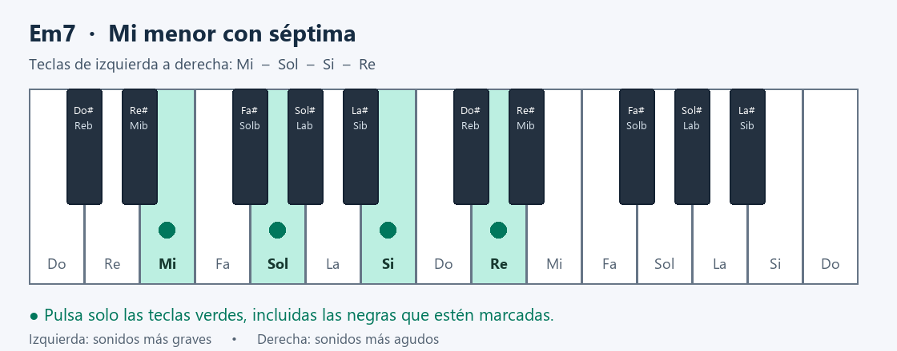

### Paso 57 · 03:13.0 → 03:16.5

**Mi menor (Em)** · Mi – Sol – Si

**03:16.5 → 03:18.6 · Pausa / audio débil:** no hay un acorde identificado en este tramo.

[Volver al inicio](#piano-paso-a-paso)
