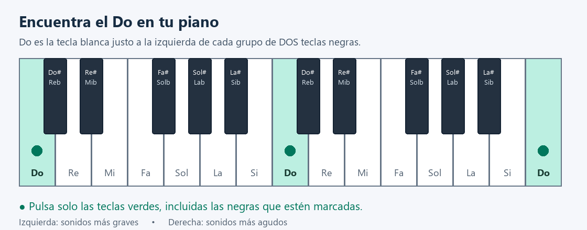

# Piano paso a paso: Moonlight y Neela

Esta guía te muestra **qué teclas pulsar con dibujos**, aunque todavía no sepas leer música. Los acordes se han estimado a partir del audio de los vídeos: pueden contener errores y no reproducen todas las notas de la melodía.

## 1. Encuentra las notas en tu teclado

Las teclas negras forman grupos de **dos** y de **tres**. Busca un grupo de dos: la tecla blanca justo a su izquierda es **Do**. Desde ahí, las blancas son **Do, Re, Mi, Fa, Sol, La, Si**, y vuelve a empezar Do.

Los dibujos muestran un trozo de teclado que empieza en Do. Busca ese mismo patrón cerca del centro de tu piano. No necesitas contar todas las teclas del instrumento.

**Cómo leer los dibujos:** pulsa solo las teclas verdes con un punto. Algunas serán blancas y otras negras. Las teclas que no están marcadas no se tocan. Los puntos indican teclas, no números de dedos.

Una tecla negra puede tener dos nombres: **Do♯ y Re♭ son la misma tecla**, por ejemplo. ♯ significa «sostenido» y ♭ significa «bemol». En los dibujos aparecen ambos nombres para que puedas encontrarla; se escriben con # y b (por ejemplo, Do# y Reb).

## 2. Empieza con una mano y sin el vídeo

1. Empieza con **Neela**, que tiene menos acordes diferentes en esta guía.
2. Mira el dibujo de **Em (Mi menor)** y localiza las tres teclas verdes.
3. Púlsalas primero **de una en una, de izquierda a derecha**. Después prueba a tocarlas juntas: eso es un acorde.
4. Cuando estés cómodo, pasa al dibujo siguiente. Practica despacio, sin intentar seguir todavía los tiempos.
5. Si no llegas cómodamente a todas las teclas, repártelas entre las dos manos o tócalas una detrás de otra. No hace falta mantener una sola mano estirada.

Por ahora puedes tocar solo las teclas de los dibujos. Más adelante, para acompañar, puedes añadir con la izquierda la primera nota del dibujo en una zona más grave del teclado.

### Tu primer ejercicio: el comienzo de Neela

Practica estos tres dibujos en orden. En cada uno, pulsa las teclas verdes juntas y cuenta lentamente **1, 2, 3, 4** antes de pasar al siguiente. Ese conteo es solo un ejercicio, no el ritmo exacto del vídeo.

**Paso 1 — Mi menor (Em): Mi + Sol + Si**

**Paso 2 — Sol mayor (G): Sol + Si + Re**

**Paso 3 — Sol con cuarta suspendida (Gsus4): Sol + Do + Re**

En los pasos 2 y 3, el Re está a la derecha del Sol, en el siguiente grupo de notas. Sigue la posición del dibujo. Después del paso 3, vuelve a Mi menor.

### Si quieres empezar por Moonlight

Su primer acorde es **Do sostenido menor (C#m)**: Do♯ + Mi + Sol♯. En el dibujo, Sol♯ también aparece como La♭: es la misma tecla negra.

## 3. Sigue las canciones

En las tablas, **pulsa el nombre de cualquier acorde para saltar a su dibujo**. La columna «Desde» indica cuándo empieza y «Hasta» cuándo cambiar al siguiente. Por ejemplo, **00:12.0** significa 12 segundos desde el inicio del vídeo. «—» indica una pausa o audio demasiado débil para reconocer el acorde.

Los cambios se estimaron cada medio segundo y pueden adelantarse o retrasarse aproximadamente un segundo. «Revisar» marca los tramos con peor ajuste. Los dibujos son posiciones propuestas para practicar; no son las posiciones exactas de las manos del intérprete.

## Moonlight

Vídeo: [Moonlight.mp4](Moonlight.mp4). Duración: 06:12.5.

### Acordes y notas para piano

| Acorde: pulsa para ver el dibujo | Nombre en español | Teclas del dibujo, de izquierda a derecha |
| --- | --- | --- |
| [C#m](#dibujo-c-sostenido-m) | Do sostenido menor | Do♯ – Mi – La♭ |
| [C#m7](#dibujo-c-sostenido-m7) | Do sostenido menor con séptima | Do♯ – Mi – La♭ – Si |
| [A](#dibujo-a) | La mayor | La – Do♯ – Mi |
| [D](#dibujo-d) | Re mayor | Re – Fa♯ – La |
| [Ab](#dibujo-ab) | La bemol mayor | La♭ – Do – Mi♭ |
| [Absus4](#dibujo-absus4) | La bemol con cuarta suspendida | La♭ – Do♯ – Mi♭ |
| [Cdim](#dibujo-cdim) | Do disminuido | Do – Mi♭ – Fa♯ |
| [E](#dibujo-e) | Mi mayor | Mi – La♭ – Si |
| [Esus4](#dibujo-esus4) | Mi con cuarta suspendida | Mi – La – Si |
| [B7](#dibujo-b7) | Si con séptima | Si – Mi♭ – Fa♯ – La |
| [Em](#dibujo-em) | Mi menor | Mi – Sol – Si |
| [G7](#dibujo-g7) | Sol con séptima | Sol – Si – Re – Fa |
| [C](#dibujo-c) | Do mayor | Do – Mi – Sol |
| [C#dim](#dibujo-c-sostenido-dim) | Do sostenido disminuido | Do♯ – Mi – Sol |
| [F#7](#dibujo-f-sostenido-7) | Fa sostenido con séptima | Fa♯ – Si♭ – Do♯ – Mi |
| [Bm](#dibujo-bm) | Si menor | Si – Re – Fa♯ |
| [G](#dibujo-g) | Sol mayor | Sol – Si – Re |
| [F#sus4](#dibujo-f-sostenido-sus4) | Fa sostenido con cuarta suspendida | Fa♯ – Si – Do♯ |
| [F#](#dibujo-f-sostenido-) | Fa sostenido mayor | Fa♯ – Si♭ – Do♯ |
| [B](#dibujo-b) | Si mayor | Si – Mi♭ – Fa♯ |
| [Cmaj7](#dibujo-cmaj7) | Do con séptima mayor | Do – Mi – Sol – Si |
| [Bdim](#dibujo-bdim) | Si disminuido | Si – Re – Fa |
| [C#7](#dibujo-c-sostenido-7) | Do sostenido con séptima | Do♯ – Fa – La♭ – Si |
| [F#m](#dibujo-f-sostenido-m) | Fa sostenido menor | Fa♯ – La – Do♯ |
| [Ebdim](#dibujo-ebdim) | Mi bemol disminuido | Mi♭ – Fa♯ – La |
| [C#](#dibujo-c-sostenido-) | Do sostenido mayor | Do♯ – Fa – La♭ |
| [F#dim](#dibujo-f-sostenido-dim) | Fa sostenido disminuido | Fa♯ – La – Do |
| [Adim](#dibujo-adim) | La disminuido | La – Do – Mi♭ |
| [Bbdim](#dibujo-bbdim) | Si bemol disminuido | Si♭ – Do♯ – Mi |
| [Cdim7](#dibujo-cdim7) | Do con séptima disminuida | Do – Mi♭ – Fa♯ – La |
| [Fm](#dibujo-fm) | Fa menor | Fa – La♭ – Do |
| [Ebm7](#dibujo-ebm7) | Mi bemol menor con séptima | Mi♭ – Fa♯ – Si♭ – Do♯ |
| [C#maj7](#dibujo-c-sostenido-maj7) | Do sostenido con séptima mayor | Do♯ – Fa – La♭ – Do |
| [Dm](#dibujo-dm) | Re menor | Re – Fa – La |
| [F](#dibujo-f) | Fa mayor | Fa – La – Do |

### Secuencia con tiempos

| Desde | Hasta | Acorde | Observación |
| --- | --- | --- | --- |
| 00:00.0 | 00:04.0 | — | Señal débil / silencio |
| 00:04.0 | 00:09.0 | [C#m](#dibujo-c-sostenido-m) |  |
| 00:09.0 | 00:11.0 | [C#m7](#dibujo-c-sostenido-m7) |  |
| 00:11.0 | 00:13.5 | [C#m](#dibujo-c-sostenido-m) |  |
| 00:13.5 | 00:16.5 | [A](#dibujo-a) |  |
| 00:16.5 | 00:19.0 | [D](#dibujo-d) |  |
| 00:19.0 | 00:20.5 | [Ab](#dibujo-ab) |  |
| 00:20.5 | 00:22.0 | [C#m](#dibujo-c-sostenido-m) |  |
| 00:22.0 | 00:23.0 | [Absus4](#dibujo-absus4) |  |
| 00:23.0 | 00:24.0 | [Cdim](#dibujo-cdim) |  |
| 00:24.0 | 00:29.5 | [C#m](#dibujo-c-sostenido-m) |  |
| 00:29.5 | 00:34.0 | [Ab](#dibujo-ab) |  |
| 00:34.0 | 00:36.5 | [C#m](#dibujo-c-sostenido-m) |  |
| 00:36.5 | 00:39.0 | [A](#dibujo-a) |  |
| 00:39.0 | 00:41.5 | [E](#dibujo-e) |  |
| 00:41.5 | 00:42.0 | [Esus4](#dibujo-esus4) |  |
| 00:42.0 | 00:44.0 | [B7](#dibujo-b7) |  |
| 00:44.0 | 00:49.0 | [E](#dibujo-e) |  |
| 00:49.0 | 00:54.5 | [Em](#dibujo-em) |  |
| 00:54.5 | 00:59.5 | [G7](#dibujo-g7) |  |
| 00:59.5 | 01:00.5 | [C](#dibujo-c) |  |
| 01:00.5 | 01:02.0 | [Em](#dibujo-em) |  |
| 01:02.0 | 01:03.0 | [C#dim](#dibujo-c-sostenido-dim) |  |
| 01:03.0 | 01:04.5 | [F#7](#dibujo-f-sostenido-7) |  |
| 01:04.5 | 01:06.5 | [Bm](#dibujo-bm) |  |
| 01:06.5 | 01:07.5 | [G](#dibujo-g) |  |
| 01:07.5 | 01:09.0 | [Em](#dibujo-em) |  |
| 01:09.0 | 01:09.5 | [F#sus4](#dibujo-f-sostenido-sus4) |  |
| 01:09.5 | 01:11.5 | [Bm](#dibujo-bm) |  |
| 01:11.5 | 01:14.0 | [F#](#dibujo-f-sostenido-) |  |
| 01:14.0 | 01:16.5 | [Bm](#dibujo-bm) |  |
| 01:16.5 | 01:19.0 | [B](#dibujo-b) |  |
| 01:19.0 | 01:20.0 | [Cmaj7](#dibujo-cmaj7) |  |
| 01:20.0 | 01:24.0 | [Em](#dibujo-em) |  |
| 01:24.0 | 01:29.0 | [B](#dibujo-b) |  |
| 01:29.0 | 01:30.0 | [Cmaj7](#dibujo-cmaj7) |  |
| 01:30.0 | 01:34.0 | [Em](#dibujo-em) |  |
| 01:34.0 | 01:37.0 | [B](#dibujo-b) |  |
| 01:37.0 | 01:39.5 | [Bdim](#dibujo-bdim) |  |
| 01:39.5 | 01:41.5 | [C#7](#dibujo-c-sostenido-7) |  |
| 01:41.5 | 01:44.0 | [F#m](#dibujo-f-sostenido-m) |  |
| 01:44.0 | 01:47.0 | [G](#dibujo-g) |  |
| 01:47.0 | 01:49.0 | [Ebdim](#dibujo-ebdim) |  |
| 01:49.0 | 01:52.5 | [F#m](#dibujo-f-sostenido-m) |  |
| 01:52.5 | 01:54.5 | [C#](#dibujo-c-sostenido-) |  |
| 01:54.5 | 01:59.5 | [F#m](#dibujo-f-sostenido-m) |  |
| 01:59.5 | 02:04.0 | [C#](#dibujo-c-sostenido-) |  |
| 02:04.0 | 02:06.0 | [F#m](#dibujo-f-sostenido-m) |  |
| 02:06.0 | 02:07.5 | [F#dim](#dibujo-f-sostenido-dim) |  |
| 02:07.5 | 02:09.0 | [F#m](#dibujo-f-sostenido-m) |  |
| 02:09.0 | 02:14.0 | [Ab](#dibujo-ab) |  |
| 02:14.0 | 02:16.5 | [C#m](#dibujo-c-sostenido-m) |  |
| 02:16.5 | 02:17.5 | [Ebdim](#dibujo-ebdim) | Revisar |
| 02:17.5 | 02:19.0 | [A](#dibujo-a) |  |
| 02:19.0 | 02:21.5 | [Ab](#dibujo-ab) |  |
| 02:21.5 | 02:23.0 | [Adim](#dibujo-adim) |  |
| 02:23.0 | 02:26.5 | [Ab](#dibujo-ab) |  |
| 02:26.5 | 02:28.0 | [Adim](#dibujo-adim) |  |
| 02:28.0 | 02:29.0 | [Cdim](#dibujo-cdim) |  |
| 02:29.0 | 02:39.0 | [C#m](#dibujo-c-sostenido-m) |  |
| 02:39.0 | 02:40.0 | [Ab](#dibujo-ab) |  |
| 02:40.0 | 02:44.0 | [Adim](#dibujo-adim) |  |
| 02:44.0 | 02:50.5 | [C#m](#dibujo-c-sostenido-m) |  |
| 02:50.5 | 02:53.5 | [Bbdim](#dibujo-bbdim) |  |
| 02:53.5 | 02:54.0 | [C#m](#dibujo-c-sostenido-m) |  |
| 02:54.0 | 02:56.5 | [Ab](#dibujo-ab) |  |
| 02:56.5 | 03:01.0 | [Cdim7](#dibujo-cdim7) |  |
| 03:01.0 | 03:06.5 | [Adim](#dibujo-adim) |  |
| 03:06.5 | 03:07.5 | [Ebdim](#dibujo-ebdim) |  |
| 03:07.5 | 03:09.0 | [F#m](#dibujo-f-sostenido-m) |  |
| 03:09.0 | 03:10.0 | [Ab](#dibujo-ab) |  |
| 03:10.0 | 03:11.5 | [F#dim](#dibujo-f-sostenido-dim) |  |
| 03:11.5 | 03:12.5 | [Ebdim](#dibujo-ebdim) |  |
| 03:12.5 | 03:14.0 | [F#m](#dibujo-f-sostenido-m) |  |
| 03:14.0 | 03:15.5 | [Ab](#dibujo-ab) |  |
| 03:15.5 | 03:16.5 | [F#dim](#dibujo-f-sostenido-dim) |  |
| 03:16.5 | 03:17.5 | [D](#dibujo-d) |  |
| 03:17.5 | 03:19.0 | [F#m](#dibujo-f-sostenido-m) |  |
| 03:19.0 | 03:20.0 | [Fm](#dibujo-fm) |  |
| 03:20.0 | 03:21.5 | [F#dim](#dibujo-f-sostenido-dim) |  |
| 03:21.5 | 03:24.0 | [A](#dibujo-a) |  |
| 03:24.0 | 03:26.5 | [Ebdim](#dibujo-ebdim) |  |
| 03:26.5 | 03:28.0 | [Ab](#dibujo-ab) |  |
| 03:28.0 | 03:29.0 | [Cdim](#dibujo-cdim) |  |
| 03:29.0 | 03:34.5 | [C#m](#dibujo-c-sostenido-m) |  |
| 03:34.5 | 03:39.0 | [Ab](#dibujo-ab) |  |
| 03:39.0 | 03:41.0 | [C#m](#dibujo-c-sostenido-m) |  |
| 03:41.0 | 03:44.0 | [A](#dibujo-a) |  |
| 03:44.0 | 03:47.0 | [E](#dibujo-e) |  |
| 03:47.0 | 03:49.0 | [B7](#dibujo-b7) |  |
| 03:49.0 | 03:54.5 | [E](#dibujo-e) |  |
| 03:54.5 | 03:59.5 | [Esus4](#dibujo-esus4) |  |
| 03:59.5 | 04:01.5 | [E](#dibujo-e) |  |
| 04:01.5 | 04:02.5 | [Fm](#dibujo-fm) |  |
| 04:02.5 | 04:04.0 | [C#m](#dibujo-c-sostenido-m) |  |
| 04:04.0 | 04:06.5 | [Ab](#dibujo-ab) |  |
| 04:06.5 | 04:09.0 | [C#m](#dibujo-c-sostenido-m) |  |
| 04:09.0 | 04:11.0 | [D](#dibujo-d) |  |
| 04:11.0 | 04:12.0 | [F#dim](#dibujo-f-sostenido-dim) |  |
| 04:12.0 | 04:13.5 | [Fm](#dibujo-fm) |  |
| 04:13.5 | 04:16.5 | [C#m](#dibujo-c-sostenido-m) |  |
| 04:16.5 | 04:19.5 | [C#](#dibujo-c-sostenido-) |  |
| 04:19.5 | 04:22.5 | [F#m](#dibujo-f-sostenido-m) |  |
| 04:22.5 | 04:23.5 | [F#dim](#dibujo-f-sostenido-dim) | Revisar |
| 04:23.5 | 04:24.0 | [F#m](#dibujo-f-sostenido-m) |  |
| 04:24.0 | 04:29.5 | [C#](#dibujo-c-sostenido-) |  |
| 04:29.5 | 04:32.5 | [F#m](#dibujo-f-sostenido-m) |  |
| 04:32.5 | 04:33.5 | [F#dim](#dibujo-f-sostenido-dim) |  |
| 04:33.5 | 04:34.0 | [F#m](#dibujo-f-sostenido-m) |  |
| 04:34.0 | 04:37.0 | [C#](#dibujo-c-sostenido-) |  |
| 04:37.0 | 04:39.0 | [F#m](#dibujo-f-sostenido-m) |  |
| 04:39.0 | 04:45.5 | [Esus4](#dibujo-esus4) |  |
| 04:45.5 | 04:46.5 | [Ebdim](#dibujo-ebdim) |  |
| 04:46.5 | 04:48.0 | [Ab](#dibujo-ab) |  |
| 04:48.0 | 04:49.5 | [C#m](#dibujo-c-sostenido-m) |  |
| 04:49.5 | 04:51.0 | [Ebm7](#dibujo-ebm7) |  |
| 04:51.0 | 04:52.5 | [Absus4](#dibujo-absus4) |  |
| 04:52.5 | 04:54.0 | [Adim](#dibujo-adim) |  |
| 04:54.0 | 04:54.5 | [Absus4](#dibujo-absus4) |  |
| 04:54.5 | 04:57.0 | [C#m](#dibujo-c-sostenido-m) |  |
| 04:57.0 | 04:59.0 | [Cdim](#dibujo-cdim) |  |
| 04:59.0 | 05:04.5 | [C#m](#dibujo-c-sostenido-m) |  |
| 05:04.5 | 05:09.0 | [Ab](#dibujo-ab) |  |
| 05:09.0 | 05:14.0 | [C#m](#dibujo-c-sostenido-m) |  |
| 05:14.0 | 05:15.5 | [Ab](#dibujo-ab) |  |
| 05:15.5 | 05:17.5 | [Adim](#dibujo-adim) |  |
| 05:17.5 | 05:18.5 | [Ab](#dibujo-ab) |  |
| 05:18.5 | 05:24.0 | [C#m](#dibujo-c-sostenido-m) |  |
| 05:24.0 | 05:25.5 | [Ab](#dibujo-ab) |  |
| 05:25.5 | 05:27.5 | [Adim](#dibujo-adim) |  |
| 05:27.5 | 05:28.5 | [Ab](#dibujo-ab) |  |
| 05:28.5 | 05:53.5 | [C#m](#dibujo-c-sostenido-m) |  |
| 05:53.5 | 05:54.0 | [C#maj7](#dibujo-c-sostenido-maj7) |  |
| 05:54.0 | 05:56.0 | — | Señal débil / silencio |
| 05:56.0 | 05:59.0 | [Dm](#dibujo-dm) |  |
| 05:59.0 | 06:02.0 | [F](#dibujo-f) |  |
| 06:02.0 | 06:04.0 | [C](#dibujo-c) |  |
| 06:04.0 | 06:07.0 | [A](#dibujo-a) |  |
| 06:07.0 | 06:08.0 | [D](#dibujo-d) |  |
| 06:08.0 | 06:12.5 | — | Señal débil / silencio |

## Neela

Vídeo: [Neela.mp4](Neela.mp4). Duración: 03:18.6.

### Acordes y notas para piano

| Acorde: pulsa para ver el dibujo | Nombre en español | Teclas del dibujo, de izquierda a derecha |
| --- | --- | --- |
| [Em](#dibujo-em) | Mi menor | Mi – Sol – Si |
| [G](#dibujo-g) | Sol mayor | Sol – Si – Re |
| [Gsus4](#dibujo-gsus4) | Sol con cuarta suspendida | Sol – Do – Re |
| [Dsus4](#dibujo-dsus4) | Re con cuarta suspendida | Re – Sol – La |
| [Gmaj7](#dibujo-gmaj7) | Sol con séptima mayor | Sol – Si – Re – Fa♯ |
| [C](#dibujo-c) | Do mayor | Do – Mi – Sol |
| [Em7](#dibujo-em7) | Mi menor con séptima | Mi – Sol – Si – Re |

### Secuencia con tiempos

| Desde | Hasta | Acorde | Observación |
| --- | --- | --- | --- |
| 00:00.0 | 00:03.5 | — | Señal débil / silencio |
| 00:03.5 | 00:12.0 | [Em](#dibujo-em) |  |
| 00:12.0 | 00:15.0 | [G](#dibujo-g) |  |
| 00:15.0 | 00:19.5 | [Gsus4](#dibujo-gsus4) |  |
| 00:19.5 | 00:22.5 | [Em](#dibujo-em) |  |
| 00:22.5 | 00:29.5 | [Gsus4](#dibujo-gsus4) |  |
| 00:29.5 | 00:32.0 | [Em](#dibujo-em) |  |
| 00:32.0 | 00:33.5 | [G](#dibujo-g) |  |
| 00:33.5 | 00:36.0 | [Dsus4](#dibujo-dsus4) |  |
| 00:36.0 | 00:39.0 | [Gsus4](#dibujo-gsus4) |  |
| 00:39.0 | 00:42.0 | [Em](#dibujo-em) |  |
| 00:42.0 | 00:43.5 | [G](#dibujo-g) |  |
| 00:43.5 | 00:46.0 | [Dsus4](#dibujo-dsus4) |  |
| 00:46.0 | 00:49.5 | [Gsus4](#dibujo-gsus4) |  |
| 00:49.5 | 00:52.0 | [Em](#dibujo-em) |  |
| 00:52.0 | 00:53.5 | [Gmaj7](#dibujo-gmaj7) |  |
| 00:53.5 | 00:59.0 | [Gsus4](#dibujo-gsus4) |  |
| 00:59.0 | 01:02.0 | [Em](#dibujo-em) |  |
| 01:02.0 | 01:03.5 | [Gmaj7](#dibujo-gmaj7) |  |
| 01:03.5 | 01:09.0 | [Gsus4](#dibujo-gsus4) |  |
| 01:09.0 | 01:11.5 | [Em](#dibujo-em) |  |
| 01:11.5 | 01:14.0 | [G](#dibujo-g) |  |
| 01:14.0 | 01:18.5 | [Gsus4](#dibujo-gsus4) |  |
| 01:18.5 | 01:21.0 | [Em](#dibujo-em) |  |
| 01:21.0 | 01:23.5 | [G](#dibujo-g) |  |
| 01:23.5 | 01:28.5 | [Gsus4](#dibujo-gsus4) |  |
| 01:28.5 | 01:31.0 | [Em](#dibujo-em) |  |
| 01:31.0 | 01:33.0 | [G](#dibujo-g) |  |
| 01:33.0 | 01:38.5 | [Gsus4](#dibujo-gsus4) |  |
| 01:38.5 | 01:46.0 | [Em](#dibujo-em) |  |
| 01:46.0 | 01:49.0 | [G](#dibujo-g) |  |
| 01:49.0 | 01:53.0 | [Gsus4](#dibujo-gsus4) |  |
| 01:53.0 | 01:56.5 | [Em](#dibujo-em) |  |
| 01:56.5 | 02:03.5 | [Gsus4](#dibujo-gsus4) |  |
| 02:03.5 | 02:06.5 | [Em](#dibujo-em) |  |
| 02:06.5 | 02:10.5 | [Dsus4](#dibujo-dsus4) |  |
| 02:10.5 | 02:13.0 | [Gsus4](#dibujo-gsus4) |  |
| 02:13.0 | 02:16.0 | [Em](#dibujo-em) |  |
| 02:16.0 | 02:17.5 | [G](#dibujo-g) |  |
| 02:17.5 | 02:20.0 | [Dsus4](#dibujo-dsus4) |  |
| 02:20.0 | 02:22.0 | [C](#dibujo-c) |  |
| 02:22.0 | 02:23.0 | [Gsus4](#dibujo-gsus4) |  |
| 02:23.0 | 02:26.0 | [Em](#dibujo-em) |  |
| 02:26.0 | 02:27.5 | [Gmaj7](#dibujo-gmaj7) |  |
| 02:27.5 | 02:33.0 | [Gsus4](#dibujo-gsus4) |  |
| 02:33.0 | 02:35.5 | [Em](#dibujo-em) |  |
| 02:35.5 | 02:37.0 | [Gmaj7](#dibujo-gmaj7) |  |
| 02:37.0 | 02:42.5 | [Gsus4](#dibujo-gsus4) |  |
| 02:42.5 | 02:45.0 | [Em](#dibujo-em) |  |
| 02:45.0 | 02:47.5 | [Dsus4](#dibujo-dsus4) |  |
| 02:47.5 | 02:52.0 | [Gsus4](#dibujo-gsus4) |  |
| 02:52.0 | 02:54.5 | [Em](#dibujo-em) |  |
| 02:54.5 | 02:57.5 | [Dsus4](#dibujo-dsus4) |  |
| 02:57.5 | 03:01.5 | [Gsus4](#dibujo-gsus4) |  |
| 03:01.5 | 03:04.5 | [Em](#dibujo-em) |  |
| 03:04.5 | 03:11.5 | [G](#dibujo-g) |  |
| 03:11.5 | 03:13.0 | [Em7](#dibujo-em7) |  |
| 03:13.0 | 03:16.5 | [Em](#dibujo-em) |  |
| 03:16.5 | 03:18.6 | — | Señal débil / silencio |

## 4. Todos los dibujos de acordes

Busca aquí el nombre que aparece en la tabla. Cada dibujo marca una sola posición para tocar ese acorde. **Pulsa todas sus teclas verdes juntas**, o una a una si estás empezando.

### Dibujo c-sostenido-m

**C#m — Do sostenido menor**

### Dibujo c-sostenido-m7

**C#m7 — Do sostenido menor con séptima**

### Dibujo a

**A — La mayor**

### Dibujo d

**D — Re mayor**

### Dibujo ab

**Ab — La bemol mayor**

### Dibujo absus4

**Absus4 — La bemol con cuarta suspendida**

### Dibujo cdim

**Cdim — Do disminuido**

### Dibujo e

**E — Mi mayor**

### Dibujo esus4

**Esus4 — Mi con cuarta suspendida**

### Dibujo b7

**B7 — Si con séptima**

### Dibujo em

**Em — Mi menor**

### Dibujo g7

**G7 — Sol con séptima**

### Dibujo c

**C — Do mayor**

### Dibujo c-sostenido-dim

**C#dim — Do sostenido disminuido**

### Dibujo f-sostenido-7

**F#7 — Fa sostenido con séptima**

### Dibujo bm

**Bm — Si menor**

### Dibujo g

**G — Sol mayor**

### Dibujo f-sostenido-sus4

**F#sus4 — Fa sostenido con cuarta suspendida**

### Dibujo f-sostenido-

**F# — Fa sostenido mayor**

### Dibujo b

**B — Si mayor**

### Dibujo cmaj7

**Cmaj7 — Do con séptima mayor**

### Dibujo bdim

**Bdim — Si disminuido**

### Dibujo c-sostenido-7

**C#7 — Do sostenido con séptima**

### Dibujo f-sostenido-m

**F#m — Fa sostenido menor**

### Dibujo ebdim

**Ebdim — Mi bemol disminuido**

### Dibujo c-sostenido-

**C# — Do sostenido mayor**

### Dibujo f-sostenido-dim

**F#dim — Fa sostenido disminuido**

### Dibujo adim

**Adim — La disminuido**

### Dibujo bbdim

**Bbdim — Si bemol disminuido**

### Dibujo cdim7

**Cdim7 — Do con séptima disminuida**

### Dibujo fm

**Fm — Fa menor**

### Dibujo ebm7

**Ebm7 — Mi bemol menor con séptima**

### Dibujo c-sostenido-maj7

**C#maj7 — Do sostenido con séptima mayor**

### Dibujo dm

**Dm — Re menor**

### Dibujo f

**F — Fa mayor**

### Dibujo gsus4

**Gsus4 — Sol con cuarta suspendida**

### Dibujo dsus4

**Dsus4 — Re con cuarta suspendida**

### Dibujo gmaj7

**Gmaj7 — Sol con séptima mayor**

### Dibujo em7

**Em7 — Mi menor con séptima**

## Sobre esta guía

Se conserva la secuencia de la transcripción automática anterior. El análisis del audio estima la armonía; los dibujos añaden una forma de tocar sus acordes. No se han deducido digitaciones, inversiones ni octavas originales del vídeo. Esta guía es un acompañamiento aproximado para practicar, no una partitura completa.
